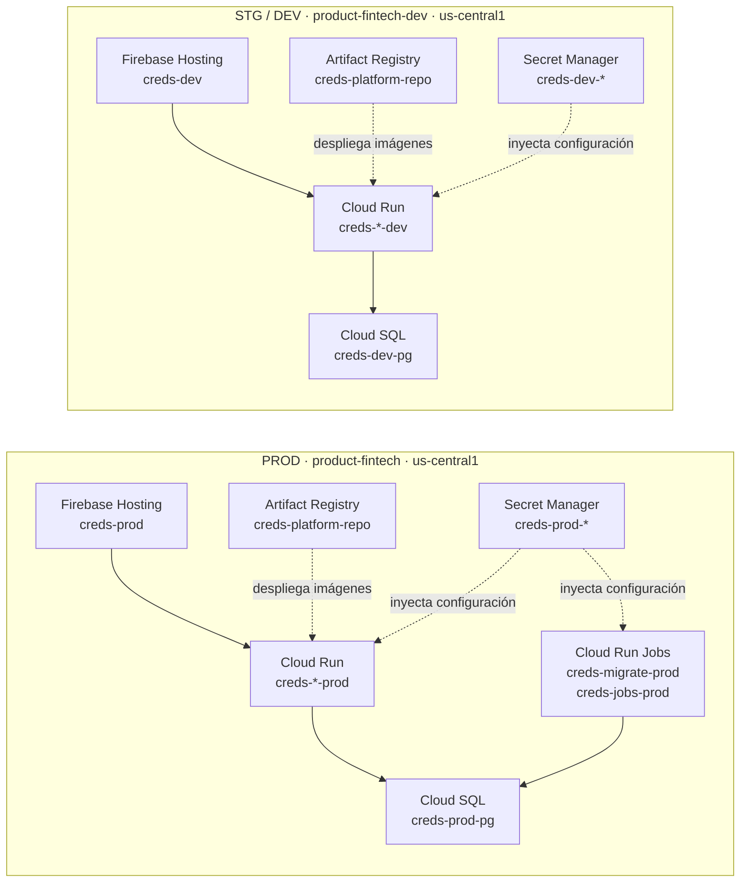
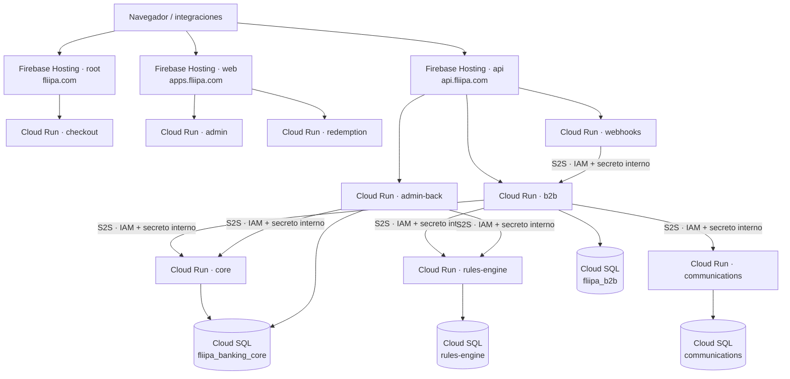
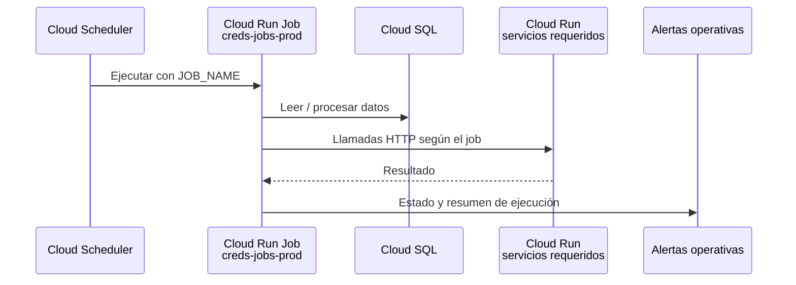

# Arquitectura y entornos

Resumen de la infraestructura desplegada en Google Cloud Platform (GCP), sus entornos y las rutas principales de tráfico. Los archivos de configuración son la fuente de verdad para proyectos, servicios, capacidad, dominios y secretos.

## Entornos y aislamiento

PROD y STG/DEV son proyectos GCP distintos. Cada entorno mantiene sus propios recursos de Cloud SQL, Artifact Registry, Secret Manager, Cloud Run y service accounts. Los nombres de runtime service accounts pueden coincidir, pero sus identidades y permisos están dentro del proyecto correspondiente.

| | **PROD** | **STG / DEV** |
|---|---|---|
| Proyecto GCP | `product-fintech` | `product-fintech-dev` |
| Región | `us-central1` | `us-central1` |
| Matriz de servicios | [`prod-service-matrix.json`](../../config/deploy/prod-service-matrix.json) | [`dev-service-matrix.json`](../../config/deploy/dev-service-matrix.json) |
| Configuración GCP local | [`gcp-prod.env`](../../config/deploy/gcp-prod.env) | [`gcp-dev.env`](../../config/deploy/gcp-dev.env) |
| Cloud SQL | `creds-prod-pg` | `creds-dev-pg` (`db-f1-micro`) |
| Firebase Hosting default | `creds-prod.web.app` | `creds-dev.web.app` |
| Variable `ENVIRONMENT` | `prod` | `staging` |
| Workflow de deploy | `PROD - deploy` | `DEV - deploy` |



Los scripts de deploy fijan el proyecto esperado mediante `pin_prod_deploy_context` o `pin_dev_deploy_context` y validan que coincida con `projectId` de la matriz. Esto evita aplicar cambios a un proyecto distinto del entorno seleccionado. No se deben apuntar servicios de un proyecto a bases de datos, secretos o imágenes del otro.

## Entrada pública y llamadas entre servicios

Firebase Hosting es el front door configurado actualmente; no hay un HTTPS Load Balancer de GCP delante de la flota. En PROD, los dominios personalizados se configuran en [`domains.prod.env`](../../config/deploy/domains.prod.env). Firebase Hosting reescribe las solicitudes hacia los servicios Cloud Run correspondientes.

| Host PROD | Servicio / rutas |
|---|---|
| `https://fliipa.com` | Checkout en `/` |
| `https://apps.fliipa.com` | Admin en `/admin`; redemption en `/redemption` |
| `https://api.fliipa.com` | B2B en `/api/v1/*`; admin-back en `/admin/api/v1/*`; webhooks en `/api/v1/webhooks/*` |
| `https://creds-prod.web.app` | Host default de Firebase Hosting; conserva `/admin` en paralelo |

STG/DEV sigue el mismo esquema usando `dev.fliipa.com`, `dev-apps.fliipa.com` y `dev-api.fliipa.com`, además del host default `creds-dev.web.app`. Los orígenes están definidos en [`domains.dev.env`](../../config/deploy/domains.dev.env).



`core`, `rules-engine` y `communications` usan acceso Cloud Run IAM y no deben exponerse a través del proxy público. Las llamadas servicio-a-servicio autentican con ID token mediante `authenticatedFetch` y agregan `X-Internal-Service-Secret` como defensa adicional. El detalle de rutas, auth y operación está en [Acceso a APIs internas](./internal-api-access.md).

> **Ruteo:** usar rutas concretas por servicio. No enviar un `/api/**` genérico a varios backends ni publicar los servicios IAM detrás de Firebase Hosting.

## Componentes cloud de PROD

| Componente | Recursos / función |
|---|---|
| Cloud SQL | Instancia `creds-prod-pg`, PostgreSQL con cuatro bases lógicas |
| Artifact Registry | `creds-platform-repo`, imágenes de los servicios |
| Secret Manager | Secretos de runtime y registro de URLs |
| Cloud Run services | Nueve servicios definidos en la matriz PROD |
| Cloud Run Jobs | `creds-migrate-prod` para migraciones; `creds-jobs-prod` para tareas batch |
| Cloud Scheduler | Ejecuta el job batch con overrides de `JOB_NAME` |
| Firebase Hosting | Sitios `root`, `web` y `api` para los dominios públicos |

Bases lógicas predeterminadas en `terraform/modules/cloud_sql`:

| Base de datos | Consumidores principales |
|---|---|
| `fliipa_banking_core` | `backends/core` y `backends/admin` (admin-back) |
| `fliipa_b2b` | `backends/b2b`; incluye `product_settings` |
| `rules-engine` | `services/rules-engine` |
| `communications` | `services/communications` |

El nombre de una base de datos no implica una instancia compartida entre entornos: PROD utiliza `creds-prod-pg` y STG/DEV `creds-dev-pg`.

## Flota de servicios PROD

[`prod-service-matrix.json`](../../config/deploy/prod-service-matrix.json) define paquete, imagen, nombre Cloud Run, tier, acceso, service account de runtime, health check, base de datos e invocadores. El orden de despliegue está en `deployOrder`.

| Slug | Paquete | Cloud Run | Tipo | Tier | Acceso | Runtime SA | Base de datos |
|---|---|---|---|---|---|---|---|
| `rules-engine` | `services/rules-engine` | `creds-rules-engine-prod` | Node | medium | IAM | `creds-runtime-product` | `rules-engine` |
| `core` | `backends/core` | `creds-core-prod` | Node | production | IAM | `creds-runtime-core` | `fliipa_banking_core` |
| `communications` | `services/communications` | `creds-communications-prod` | Node | medium | IAM | `creds-runtime-product` | `communications` |
| `webhooks` | `services/webhooks` | `creds-webhooks-prod` | Node | cheap | público | `creds-runtime-public` | — |
| `b2b` | `backends/b2b` | `creds-b2b-prod` | Node | production | público | `creds-runtime-public` | `fliipa_b2b` |
| `admin-back` | `backends/admin` | `creds-admin-back-prod` | Node | medium | público | `creds-runtime-public` | `fliipa_banking_core` |
| `checkout` | `apps/checkout` | `creds-checkout-prod` | Next.js | production | público | `creds-runtime-public` | — |
| `redemption` | `apps/redemption` | `creds-redemption-prod` | Next.js | production | público | `creds-runtime-public` | — |
| `admin` | `apps/admin` | `creds-admin-prod` | Next.js | cheap | público | `creds-runtime-public` | — |

Los tiers fijan los valores predeterminados de escalado y recursos; la matriz también permite overrides por servicio:

| Tier | Min / max instances | Concurrency | CPU | Memoria | Timeout |
|---|---:|---:|---:|---:|---:|
| `production` | 2 / 20 | 50 | 2 | 1 GiB | 60 s |
| `medium` | 1 / 10 | 50 | 1 | 512 MiB | 60 s |
| `cheap` | 0 / 2 | 20 | 1 | 512 MiB | 60 s |

En STG/DEV, todos los servicios usan `cheap` por defecto (scale-to-zero). Cloud SQL usa `db-f1-micro` (~25 conexiones), así que los pools deben mantenerse bajos (`DB_POOL_MAX=2–3`). Ver [Staging / demo](./dev-staging.md).

## Jobs y migraciones

`creds-migrate-prod` ejecuta migraciones TypeORM. `creds-jobs-prod` empaqueta handlers batch; Cloud Scheduler lo invoca y configura `JOB_NAME` para seleccionar el handler.



Configuración y operación de jobs: [`scripts/provision-prod-jobs.sh`](../../scripts/provision-prod-jobs.sh), [`scripts/provision-prod-jobs-schedulers.sh`](../../scripts/provision-prod-jobs-schedulers.sh) y [day-to-day.md](./day-to-day.md). Los Jobs no forman parte de la matriz de servicios Cloud Run.

## Despliegue y mapa código ↔ cloud

Los workflows de GitHub Actions usan Workload Identity Federation. Los despliegues declarativos de infraestructura usan Terraform/OpenTofu; los scripts de entorno son wrappers y runbooks para operaciones manuales y tareas de soporte.

```text
config/deploy/
  gcp-prod.env                    Proyecto/región y nombres base de PROD
  gcp-dev.env                     Proyecto/región y nombres base de STG/DEV
  domains.prod.env                Orígenes y paths públicos de PROD
  domains.dev.env                 Orígenes y paths públicos de STG/DEV
  prod-service-matrix.json        Flota, capacidad, IAM y orden de PROD
  dev-service-matrix.json         Flota, capacidad, IAM y orden de STG/DEV
  service-catalog.json            Slug → paquete / Cloud Run
  url-bindings.json               Variables de URL servicio-a-servicio
  runtime-secrets.json            Catálogo Secret Manager → servicios

terraform/
  bootstrap/                      APIs, state, WIF y recursos iniciales
  modules/                        Cloud SQL, Cloud Run, Firebase Hosting, IAM
  envs/prod/                      Infraestructura declarativa de PROD
  envs/dev/                       Infraestructura declarativa de STG/DEV

scripts/
  pdeploy-prod.sh                 Deploy manual PROD
  deploy-dev.sh                   Deploy manual STG/DEV
  prod-runtime-secrets.sh         Gestión/verificación de secretos PROD
  prod-urls.sh                    Sync y verificación de URLs PROD
  provision-prod-jobs.sh          Cloud Run Job batch PROD
  provision-prod-jobs-schedulers.sh  Cloud Scheduler → JOB_NAME

.github/workflows/
  prod-deploy.yml                 Workflow PROD
  dev-deploy.yml                  Workflow STG/DEV
  dev-rollback.yml                Rollback STG/DEV
  dev-db-restore.yml              Restore de base de datos STG/DEV
```

Referencias operativas:

- [Deploy PROD](../PROD-DEPLOY.md)
- [Staging / demo](./dev-staging.md)
- [Operación diaria](./day-to-day.md)
- [Acceso a APIs internas](./internal-api-access.md)
- [Dominio y Load Balancer](./domain-lb.md)
- [Checklist de release](./ship-checklist.md)

## Fuentes de verdad

Si la documentación y la configuración discrepan, verificar primero estos archivos antes de desplegar:

1. Proyectos y recursos base: [`gcp-prod.env`](../../config/deploy/gcp-prod.env), [`gcp-dev.env`](../../config/deploy/gcp-dev.env).
2. Servicios y capacidad: [`prod-service-matrix.json`](../../config/deploy/prod-service-matrix.json), [`dev-service-matrix.json`](../../config/deploy/dev-service-matrix.json).
3. Orígenes públicos: [`domains.prod.env`](../../config/deploy/domains.prod.env), [`domains.dev.env`](../../config/deploy/domains.dev.env).
4. Secretos y mounts: [`runtime-secrets.json`](../../config/deploy/runtime-secrets.json).
5. Infraestructura declarativa: [`terraform/envs/prod`](../../terraform/envs/prod), [`terraform/envs/dev`](../../terraform/envs/dev).