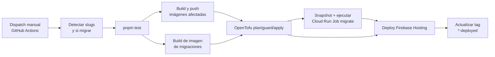

# Pipeline de despliegue (CI/CD)

Este documento describe los flujos de despliegue vigentes para PROD y STG/DEV. Los workflows actuales son **dispatch-only**: no despliegan automáticamente en cada push. Ambos detectan los servicios afectados, corren tests, construyen las imágenes necesarias y aplican la infraestructura con OpenTofu.

La matriz de cada entorno es la fuente de verdad para servicios, nombres Cloud Run, capacidad y configuración:

- PROD: [`config/deploy/prod-service-matrix.json`](https://github.com/SumzCol/credits-platform/blob/main/config/deploy/prod-service-matrix.json)
- STG/DEV: [`config/deploy/dev-service-matrix.json`](https://github.com/SumzCol/credits-platform/blob/main/config/deploy/dev-service-matrix.json)

## Resumen del flujo



Los pasos de migración se ejecutan solamente cuando la detección determina `run_migrate=true`. La ejecución final requiere que los tests hayan pasado y que los builds necesarios hayan terminado correctamente. Si no hay imágenes que reconstruir, el deploy puede seguir para aplicar cambios de infraestructura.

## GitHub Actions

| Entorno | Workflow | Archivo | Ejecución |
|---|---|---|---|
| PROD | `PROD - deploy` | [`prod-deploy.yml`](https://github.com/SumzCol/credits-platform/blob/main/.github/workflows/prod-deploy.yml) | Manual, con `workflow_dispatch` |
| STG/DEV | `DEV - deploy` | [`dev-deploy.yml`](https://github.com/SumzCol/credits-platform/blob/main/.github/workflows/dev-deploy.yml) | Manual, con `workflow_dispatch` |

No hay un workflow vigente por servicio ni deploy automático por push. Para iniciar un despliegue desde GitHub CLI:

```bash
# PROD
gh workflow run prod-deploy.yml -f slugs=auto -f migrate=auto

# STG/DEV
gh workflow run dev-deploy.yml -f slugs=auto -f migrate=auto

# Consultar runs
gh run list --workflow=prod-deploy.yml --limit 5
gh run list --workflow=dev-deploy.yml --limit 5
gh run watch
```

Los workflows usan Workload Identity Federation para autenticarse con GCP; no requieren una llave JSON de service account en el runner. PROD usa el GitHub Environment `prod`; STG/DEV usa `dev`. Sus variables y secretos están configurados por entorno.

### Selección de servicios y migraciones

Ambos workflows aceptan:

| Input | Valores | Comportamiento |
|---|---|---|
| `slugs` | `auto` | Despliega los servicios detectados desde el último deploy exitoso |
| `slugs` | CSV, por ejemplo `b2b,admin-back` | Despliega los slugs indicados |
| `slugs` | `all` | Selecciona toda la flota |
| `migrate` | `auto` | Migra si los slugs incluyen servicios con migraciones o si se selecciona `all` |
| `migrate` | `on` | Fuerza la ejecución de migraciones |
| `migrate` | `off` | Omite migraciones, incluso con `slugs=all` |

Ejemplos:

```bash
gh workflow run dev-deploy.yml -f slugs=b2b,admin-back -f migrate=auto
gh workflow run prod-deploy.yml -f slugs=all -f migrate=off
```

`auto` compara los cambios contra el tag del último despliegue exitoso (`dev-deployed` o `prod-deployed`), para incluir commits acumulados desde esa ejecución. Los cambios compartidos —por ejemplo en `packages/`, lockfile o configuración del grafo de build— pueden seleccionar toda la flota. Los cambios bajo `terraform/` pueden ejecutar el apply sin reconstruir imágenes. La lógica está en [`scripts/detect-changed-services.py`](https://github.com/SumzCol/credits-platform/blob/main/scripts/detect-changed-services.py).

La migración automática aplica a los paquetes de base de datos `b2b`, `communications` y `rules-engine`; el workflow también puede forzarla con `migrate=on`. Antes de migrar, se crean snapshots de las bases de datos del entorno en el bucket de snapshots correspondiente. Después se ejecuta `creds-migrate-prod` o `creds-migrate-dev`.

El input `bootstrap` existe en PROD únicamente para el primer aprovisionamiento intencional de la flota cuando el state está vacío. No debe usarse en despliegues ordinarios.

## Despliegue manual desde laptop

Los scripts CLI siguen disponibles como alternativa operativa. Fijan el proyecto esperado y validan que coincida con el entorno seleccionado. Para despliegues regulares de código en STG/DEV, el workflow `DEV - deploy` es el camino recomendado; la CLI es útil para bootstrap, infraestructura, secretos, seeds y fallback.

### PROD

```bash
# Toda la flota
bash scripts/pdeploy-prod.sh --all

# Servicios específicos
bash scripts/pdeploy-prod.sh webhooks b2b

# Plan sin mutar GCP
bash scripts/pdeploy-prod.sh webhooks --dry-run

# Forzar rebuild/redeploy
bash scripts/pdeploy-prod.sh checkout --force

# Scaffold y deploy de un paquete nuevo
bash scripts/pdeploy-prod.sh --package apps/nuevo
```

`pdeploy-prod.sh` fija el contexto PROD (`product-fintech`) y ejecuta el bootstrap/deploy definido por los scripts del repositorio. Para el pipeline de GitHub, usar [`prod-deploy.yml`](https://github.com/SumzCol/credits-platform/blob/main/.github/workflows/prod-deploy.yml); no hay workflows `creds-*-prod.yml` separados por servicio.

### STG/DEV

```bash
# Despliegue interactivo de flota
pnpm deploy:dev

# Un servicio; rebuild según fingerprint de contenido
pnpm deploy:dev -- admin-back

# Forzar rebuild/redeploy de los slugs seleccionados
pnpm deploy:dev -- core admin-back --force

# Validar/provisionar infraestructura, migrar y desplegar
pnpm deploy:dev -- --with-infra --with-migrate --with-build

# Plan sin mutar GCP
bash scripts/deploy-dev.sh --dry-run
```

Con slugs explícitos, `deploy-dev.sh` omite por defecto infraestructura, migraciones y seed de secretos, pero puede reconstruir el servicio si cambió el fingerprint. Los flags `--with-infra`, `--with-migrate`, `--with-build` y `--with-secrets` habilitan explícitamente esas etapas. Ver el detalle de operación en [Operación diaria, rollback y pendientes](06 Operacion y Pendientes.md).

## Controles de seguridad y consistencia

- Los proyectos están separados: PROD es `product-fintech`; STG/DEV es `product-fintech-dev`.
- Los workflows de Actions obtienen credenciales GCP mediante Workload Identity Federation.
- Antes del apply se verifica la existencia de secretos requeridos por los mounts.
- OpenTofu revisa el state y aborta si el plan intenta recrear recursos vivos protegidos —como Cloud SQL o Cloud Run— en vez de actualizar la infraestructura existente.
- Los deploys de PROD no se cancelan a mitad del proceso (`cancel-in-progress: false`). DEV puede cancelar una ejecución anterior de la misma rama.
- Los tags `prod-deployed` y `dev-deployed` avanzan únicamente tras un deploy exitoso y se usan como referencia para detectar cambios acumulados.

## URLs entre servicios

Las URLs entre servicios se derivan de `url-bindings.json`, las matrices y la configuración de dominios. Para cambios que afecten URLs consumidas por otros servicios, verificar la sincronización del registro:

```bash
# PROD
bash scripts/prod-urls.sh
bash scripts/prod-urls.sh verify

# STG/DEV
pnpm env:sync:dev
pnpm env:sync:dev -- verify
```

La documentación de arquitectura y dominios está en [Arquitectura y entornos](01 Arquitectura y Entornos.md) y [Dominios públicos y Load Balancer](05 Dominio y Load Balancer.md); los runbooks operativos están en [Operación diaria, rollback y pendientes](06 Operacion y Pendientes.md).

## Rollback

- **PROD:** mover el tráfico de Cloud Run a una revisión anterior o volver a ejecutar `prod-deploy.yml` con el SHA conocido como bueno y `migrate=off`. No hay workflow de restore de base de datos PROD.
- **STG/DEV:** usar `dev-rollback.yml` para rollback de código. La restauración de una base de datos STG/DEV, si se requiere, es una operación aparte documentada en `dev-db-restore.yml`.
- Una reversión de código no revierte automáticamente una migración ya aplicada; considerar compatibilidad de esquema y el snapshot previo antes de elegir la recuperación.

## Referencias

- [Arquitectura y entornos](01 Arquitectura y Entornos.md)
- [Configuración, variables de entorno y secretos](03 Configuracion y Secretos.md)
- [Jobs batch y migraciones de base de datos](04 Jobs y Migraciones.md)
- [Operación diaria, rollback y pendientes](06 Operacion y Pendientes.md)
- [`prod-deploy.yml`](https://github.com/SumzCol/credits-platform/blob/main/.github/workflows/prod-deploy.yml)
- [`dev-deploy.yml`](https://github.com/SumzCol/credits-platform/blob/main/.github/workflows/dev-deploy.yml)
