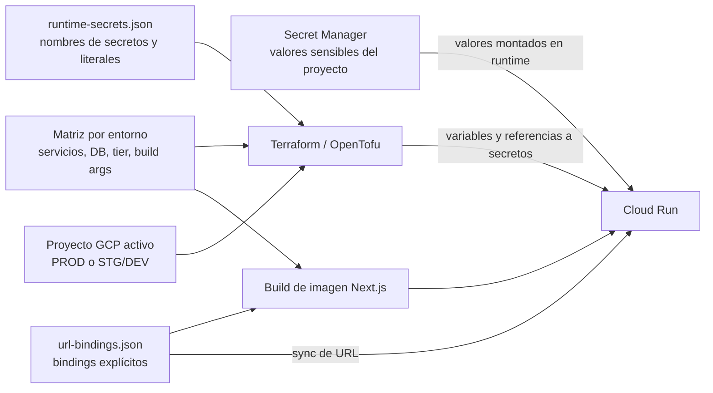

# Configuración, variables de entorno y secretos

La configuración de despliegue vive principalmente en `config/deploy/` y se versiona en el repositorio. Los valores sensibles se almacenan en Secret Manager en el proyecto GCP de cada entorno; los archivos locales con valores son *gitignored*. PROD y STG/DEV comparten el catálogo de nombres y variables, pero no comparten proyectos ni valores de secretos.

## Archivos de configuración

| Archivo | Responsabilidad |
|---|---|
| [`gcp-prod.env`](https://github.com/SumzCol/credits-platform/blob/main/config/deploy/gcp-prod.env) / [`gcp-dev.env`](https://github.com/SumzCol/credits-platform/blob/main/config/deploy/gcp-dev.env) | Proyecto, región, Artifact Registry, Firebase Hosting y Cloud SQL por entorno |
| [`domains.prod.env`](https://github.com/SumzCol/credits-platform/blob/main/config/deploy/domains.prod.env) / [`domains.dev.env`](https://github.com/SumzCol/credits-platform/blob/main/config/deploy/domains.dev.env) | `DEPLOY_PHASE`, orígenes y paths públicos de cada entorno |
| [`prod-service-matrix.json`](https://github.com/SumzCol/credits-platform/blob/main/config/deploy/prod-service-matrix.json) / [`dev-service-matrix.json`](https://github.com/SumzCol/credits-platform/blob/main/config/deploy/dev-service-matrix.json) | Servicios Cloud Run, paquete, imagen, tier, acceso, service account, health path y base de datos |
| [`service-catalog.json`](https://github.com/SumzCol/credits-platform/blob/main/config/deploy/service-catalog.json) / [`service-catalog.dev.json`](https://github.com/SumzCol/credits-platform/blob/main/config/deploy/service-catalog.dev.json) | Mapeo de slug a paquete y nombre de Cloud Run por entorno |
| [`url-bindings.json`](https://github.com/SumzCol/credits-platform/blob/main/config/deploy/url-bindings.json) | Bindings explícitos de URLs calculadas para paquetes; incluye bindings marcados `buildTime` |
| [`runtime-secrets.json`](https://github.com/SumzCol/credits-platform/blob/main/config/deploy/runtime-secrets.json) | Catálogo de secretos, variables destino, servicios que los montan y literales comunes/DEV |
| [`iam-deploy-engineer-role.yaml`](https://github.com/SumzCol/credits-platform/blob/main/config/deploy/iam-deploy-engineer-role.yaml) | Permisos versionados del rol custom `deployEngineer` para operaciones desde laptop |
| [`runtime-secrets.local.env.example`](https://github.com/SumzCol/credits-platform/blob/main/config/deploy/runtime-secrets.local.env.example) | Plantilla sin valores para el archivo local opcional de aprovisionamiento |

Valores base por entorno y nombres exactos de recursos: [Arquitectura y entornos](01 Arquitectura y Entornos.md). Flujo de despliegue y comandos: [Pipeline CI/CD](02 Pipeline de Despliegue.md).

## Cómo llega una variable a Cloud Run

| Tipo de configuración | Fuente | Entrega |
|---|---|---|
| Secreto | `runtime-secrets.json` y valor correspondiente en Secret Manager | Referencia al secreto/versión montada en Cloud Run |
| Literal de runtime | `serviceEnvLiterals` en `runtime-secrets.json`; STG/DEV agrega o sobreescribe con `serviceEnvLiteralsDev` | Variables de entorno del servicio |
| Variable generada por entorno | Matriz, dominios y configuración Terraform | Terraform compone `ENVIRONMENT`, variables de DB, URLs runtime y otros valores por servicio |
| URL binding explícito | `url-bindings.json` | Herramientas de sincronización de URLs; algunos bindings se inyectan durante el build |
| Build-time de Next.js | `staticBuildArgs` de la matriz y bindings con `buildTime: true` | Argumentos de build de Docker; quedan incluidos en la imagen/bundle |



En las configuraciones Terraform actuales, varias URLs de servicio-a-servicio se componen desde las URLs Cloud Run y los dominios del entorno. `url-bindings.json` no es una lista exhaustiva de todas las variables URL runtime. Consultar también `terraform/envs/prod/config.tf` y `terraform/envs/dev/config.tf` al cambiar o añadir una integración.

### Regla para agregar una variable

Cada variable declarada en el `.env.example` de un paquete debe quedar cubierta por una fuente de configuración de despliegue: catálogo de secretos, literales, URL binding, variables generadas por Terraform o `staticBuildArgs`. Ejecutar el verificador para el entorno afectado:

```bash
python3 scripts/lib/verify_deploy_env_coverage.py --env dev
python3 scripts/lib/verify_deploy_env_coverage.py --env prod
```

`deploy-dev.sh` ejecuta el gate de cobertura para DEV. Antes de cambiar la configuración, determinar si el valor es secreto, literal de runtime o valor de build. No poner credenciales ni datos privados en literales, matrices, bindings o argumentos `NEXT_PUBLIC_*`.

## Secretos y Secret Manager

`runtime-secrets.json` define para cada secreto su `secretName`, `envVar` y los slugs que lo reciben. El archivo describe el catálogo; los valores viven en Secret Manager, separado por proyecto:

- PROD: Secret Manager de `product-fintech`.
- STG/DEV: Secret Manager de `product-fintech-dev`.

El nombre del secreto puede ser igual en ambos proyectos, pero el valor/versionado es independiente. Algunos grupos del catálogo incluyen JWT e integración interna, secretos de webhooks, credenciales de Druo y proveedores de comunicaciones, y credenciales opcionales de Experian/Score. Revisar el catálogo para el inventario actualizado; no copiar valores sensibles a documentación.

`DB_USER` y `DB_PASSWORD` también se montan desde Secret Manager para servicios conectados a Cloud SQL, aunque se agregan en Terraform aparte del arreglo `secrets` del catálogo.

**Importante sobre `required`:** Terraform monta todas las entradas del catálogo asignadas a un servicio, sin filtrar por `required`. Por eso, el secreto debe existir en Secret Manager aunque su valor sea opcional para la lógica de negocio. `scripts/check-runtime-secrets.py` valida antes del apply que existan todos los secretos montados y evita que una aplicación falle parcialmente a mitad del despliegue. Un valor opcional puede usar un placeholder durante aprovisionamiento, pero debe reemplazarse antes de habilitar la integración correspondiente.

### Valores locales y operación por entorno

El archivo de valores local es opcional, ignorado por Git y no debe compartirse ni incluirse en commits:

```text
config/deploy/runtime-secrets.local.env
```

La plantilla está en [`runtime-secrets.local.env.example`](https://github.com/SumzCol/credits-platform/blob/main/config/deploy/runtime-secrets.local.env.example). El aprovisionamiento local de DEV puede leer los valores de ese archivo. En PROD, los valores se administran directamente en Secret Manager; el archivo local no es requisito para desplegar.

Operaciones de PROD:

```bash
# Crear/actualizar un secreto y su asociación a servicios
bash scripts/prod-runtime-secrets.sh put \
  --secret-name creds-example \
  --env-var EXAMPLE_SECRET \
  --value 'valor-secreto' \
  --services b2b

# Verificar catálogo y mounts
bash scripts/prod-runtime-secrets.sh verify
bash scripts/prod-runtime-secrets.sh verify-s2s
```

El argumento `--value` puede quedar en el historial del shell; para credenciales sensibles, usar el mecanismo seguro aprobado por el equipo en vez de pegar valores en comandos o chats.

Sincronización de configuración de DEV y URLs:

```bash
pnpm env:sync:dev
pnpm env:sync:dev -- verify
```

El wrapper `scripts/sync-deploy-env.sh` usa DEV por defecto; `--prod` selecciona PROD. `pnpm env:sync:dev` corre el flujo completo de cobertura, apply de secretos/literales y URLs; `pnpm env:sync:dev -- verify` valida la cobertura y la configuración ya aplicada. Para cambios de despliegue regulares, seguir el [pipeline CI/CD](02 Pipeline de Despliegue.md).

## URLs runtime y configuración de frontend

Terraform compone las URLs internas usando los nombres de Cloud Run y el proyecto activo. Las llamadas internas deben seguir usando los orígenes Cloud Run apropiados; no se deben redirigir por los dominios públicos sin una decisión explícita de arquitectura.

Las URLs y flags declarados en `staticBuildArgs` —por ejemplo, enlaces públicos, URL de soporte y `ALLOW_SEARCH_INDEXING`— se hornean en la imagen de Next.js. Los valores públicos `NEXT_PUBLIC_*` no son secretos: el navegador puede leerlos. Si cambia un argumento de build, hay que reconstruir y desplegar la app afectada; `pnpm env:sync:dev` por sí solo no actualiza la imagen.

Los IDs de las plantillas de correo y WhatsApp no se configuran como secretos de Cloud Run. Se resuelven desde los catálogos versionados:

| Canal | Catálogo | Archivo |
|---|---|---|
| Email (SendGrid) | Keys de plantilla estables que resuelven a IDs y datos requeridos | [`email-templates.ts`](https://github.com/SumzCol/credits-platform/blob/main/services/communications/src/constants/email-templates.ts) |
| WhatsApp (Zenvia) | Keys de plantilla estables que resuelven a IDs y datos requeridos | [`whatsapp-templates.ts`](https://github.com/SumzCol/credits-platform/blob/main/services/communications/src/constants/whatsapp-templates.ts) |

Las credenciales de proveedor sí son secretos (`SENDGRID_API_KEY`, `ZENVIA_API_KEY`). El número de origen de Zenvia es configuración literal. Para que un caller envíe una plantilla, pasa su key estable; `communications` resuelve el ID del proveedor.

## IAM del operador

El rol custom `deployEngineer` define permisos de mínimo privilegio para operaciones desde laptop en STG/DEV (`product-fintech-dev`), sin recurrir a `Owner`, `Editor` o administrador IAM del proyecto:

```bash
bash scripts/create-deploy-engineer-role.sh
bash scripts/create-deploy-engineer-role.sh --bind user:you@example.com
```

La lista versionada de permisos está en [`iam-deploy-engineer-role.yaml`](https://github.com/SumzCol/credits-platform/blob/main/config/deploy/iam-deploy-engineer-role.yaml). Si un paso falla por permisos, confirmar primero que el proyecto y el entorno activos son los correctos; agregar solo el permiso necesario al rol y volver a ejecutar el script.

## Cobertura y salud

La cobertura de variables se verifica con `verify_deploy_env_coverage.py`. La existencia de secretos montados se valida por separado con `check-runtime-secrets.py` en los workflows antes del apply. Son controles distintos: uno detecta variables de entorno sin fuente de configuración y el otro comprueba que existan en GCP los secretos que la flota montará.

El panel **System → Health** consulta `admin-back` (`GET /api/v1/system/core-health`) para probar la flota. Los orígenes faltantes pueden quedar como omitidos; una verificación de health no sustituye los gates de cobertura de env ni la validación de secretos.
