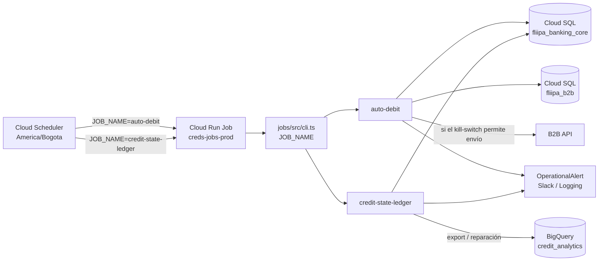

# Jobs batch y migraciones de base de datos

## Jobs batch (`jobs/`)

El paquete `@credits-platform/jobs` se compila como una imagen y se ejecuta en el Cloud Run Job PROD `creds-jobs-prod`. La variable `JOB_NAME` selecciona el handler que corre en cada ejecución. El registro vigente está en [`jobs/src/handlers/index.ts`](https://github.com/SumzCol/credits-platform/blob/main/jobs/src/handlers/index.ts).

```text
jobs/
  src/
    cli.ts                  Lee JOB_NAME o --job y ejecuta el handler
    handlers/
      index.ts              Registro de handlers
      auto-debit.ts         Funnel y ejecución de candidatos de débito Druo
      credit-state-ledger.ts Snapshot del estado calculado de créditos
    lib/
      run-context.ts
      run-with-alerts.ts
      db.ts
      logger.ts
```

Los handlers registrados actualmente son:

| `JOB_NAME` | Handler | Scheduler PROD | Función |
|---|---|---|---|
| `auto-debit` | [`auto-debit.ts`](https://github.com/SumzCol/credits-platform/blob/main/jobs/src/handlers/auto-debit.ts) | `creds-jobs-auto-debit`, `0 7 * * *` (`America/Bogota`) | Calcula el funnel diario y, si `auto_debit_send_enabled` está activo, envía los candidatos al endpoint B2B configurado |
| `credit-state-ledger` | [`credit-state-ledger.ts`](https://github.com/SumzCol/credits-platform/blob/main/jobs/src/handlers/credit-state-ledger.ts) | `creds-jobs-credit-state-ledger`, `0 0 * * *` (`America/Bogota`) | Calcula y persiste cambios del estado de crédito; exporta a BigQuery y repara filas faltantes si la configuración está habilitada |

Las entradas de scheduler están versionadas en [`scripts/provision-prod-jobs-schedulers.sh`](https://github.com/SumzCol/credits-platform/blob/main/scripts/provision-prod-jobs-schedulers.sh) como `nombre|JOB_NAME|cron`. La zona horaria se controla con `JOBS_SCHEDULER_TZ` y por defecto es `America/Bogota`. Actualmente PROD tiene dos schedulers; **no** hay schedulers batch provisionados en STG/DEV.



Cada ejecución válida pasa por `runWithAlerts` vía `@credits-platform/kernel`. `auto-debit` emite alertas operativas de ciclo de vida por el canal `druo`; `credit-state-ledger` está configurado para alertar solo ante fallos por el canal `deploy`.

### Ejecutar localmente

Desde el monorepo, con dependencias instaladas y variables locales configuradas:

```bash
cd jobs

# Seleccionar handler explícitamente
pnpm exec tsx --env-file=.env src/cli.ts --job=auto-debit
pnpm exec tsx --env-file=.env src/cli.ts --job=credit-state-ledger

# Alternativa: JOB_NAME desde el entorno
JOB_NAME=credit-state-ledger pnpm start
```

Los nombres disponibles se pueden consultar en [`jobs/src/handlers/index.ts`](https://github.com/SumzCol/credits-platform/blob/main/jobs/src/handlers/index.ts). El paquete necesita conexión a las bases que usa el handler; en producción, la exportación del ledger a BigQuery requiere la configuración `CREDIT_LEDGER_BQ_*` y permisos para el runtime service account.

### Aprovisionar y ejecutar en PROD

```bash
# Construir y publicar la imagen, y crear/actualizar el Cloud Run Job
bash scripts/provision-prod-jobs.sh

# Crear o actualizar los schedulers versionados
bash scripts/provision-prod-jobs-schedulers.sh --dry-run
bash scripts/provision-prod-jobs-schedulers.sh

# Ejecución manual de un handler
gcloud run jobs execute creds-jobs-prod \
  --region=us-central1 --project=product-fintech --wait \
  --update-env-vars=JOB_NAME=auto-debit
```

Para ejecutar otro handler, cambiar `JOB_NAME`. El horario vive en Cloud Scheduler, no en la imagen: cambiar únicamente un cron requiere volver a ejecutar el script de schedulers, no reconstruir el Job.

El Job se conecta a Cloud SQL PROD, usa `creds-runtime-product` como runtime service account y tiene timeout configurado por [`scripts/provision-prod-jobs.sh`](https://github.com/SumzCol/credits-platform/blob/main/scripts/provision-prod-jobs.sh). Para cambios de código en `jobs/` o en paquetes que la imagen consume, volver a construir/publicar con ese script. Los jobs no forman parte de las matrices de Cloud Run services.

### Añadir un handler

1. Crear `jobs/src/handlers/<nombre>.ts` y exportar un `JobDefinition`.
2. Registrarlo en [`jobs/src/handlers/index.ts`](https://github.com/SumzCol/credits-platform/blob/main/jobs/src/handlers/index.ts).
3. Añadir una fila a `JOB_SCHEDULES` en [`scripts/provision-prod-jobs-schedulers.sh`](https://github.com/SumzCol/credits-platform/blob/main/scripts/provision-prod-jobs-schedulers.sh) si debe ejecutarse periódicamente.
4. Publicar la imagen con `bash scripts/provision-prod-jobs.sh`.
5. Aplicar los schedulers con `bash scripts/provision-prod-jobs-schedulers.sh` y validar una ejecución manual.

El cambio de código requiere imagen nueva; un cambio de cron o de `JOB_NAME` requiere actualizar el scheduler. Para saber qué desplegar en cada entorno, consultar [Pipeline de despliegue](02 Pipeline de Despliegue.md) y [Operación diaria, rollback y pendientes](06 Operacion y Pendientes.md).

## Migraciones de base de datos

Las migraciones TypeORM se ejecutan como un Cloud Run Job independiente del paquete batch: `creds-migrate-prod` en PROD y `creds-migrate-dev` en STG/DEV. La imagen se construye desde [`infra/migrate/Dockerfile`](https://github.com/SumzCol/credits-platform/blob/main/infra/migrate/Dockerfile) y ejecuta [`scripts/migrate-prod-packages.sh`](https://github.com/SumzCol/credits-platform/blob/main/scripts/migrate-prod-packages.sh), que procesa en orden los paquetes que tengan el script `migration:run`:

| Paquete | Base de datos |
|---|---|
| `packages/kernel` | `fliipa_banking_core` |
| `backends/b2b` | `fliipa_b2b` |
| `services/communications` | `communications` |
| `services/rules-engine` | `rules-engine` |

El workflow detecta si corresponde migrar a partir de los servicios seleccionados y el input `migrate` (`auto`, `on` u `off`). En `auto`, se ejecutan si los slugs incluyen `b2b`, `communications` o `rules-engine`, o si el cambio es compartido (que activa toda la flota); `on` fuerza la migración y `off` la omite incluso con `all`. Antes de ejecutar migraciones, los workflows exportan snapshots SQL de las cuatro bases lógicas del entorno (`fliipa_banking_core`, `fliipa_b2b`, `communications` y `rules-engine`) al bucket `gs://<PROJECT_ID>-db-snapshots`.

El orden del proceso en CI/CD es:

1. Detectar cambios/servicios y resolver si se ejecutan migraciones.
2. Ejecutar `pnpm test`; si falla, no continúa el deploy.
3. Construir/publicar las imágenes de servicios y, cuando aplique, la imagen de migraciones.
4. Verificar secretos y el estado de OpenTofu.
5. Si hay migración, exportar snapshots de las bases (excepto bootstrap PROD).
6. Aplicar OpenTofu de forma dirigida para el Job de migración y ejecutarlo con `gcloud run jobs execute`.
7. Aplicar el resto de la infraestructura y los servicios.

Los workflows vigentes son manuales (`workflow_dispatch`): [PROD deploy](https://github.com/SumzCol/credits-platform/blob/main/.github/workflows/prod-deploy.yml) y [DEV deploy](https://github.com/SumzCol/credits-platform/blob/main/.github/workflows/dev-deploy.yml). La antigua referencia a `stg-deploy.yml` ya no aplica. Ver el detalle de inputs y comandos en [Pipeline CI/CD](02 Pipeline de Despliegue.md).

### Ejecución local/manual

Para PROD existe el wrapper [`scripts/run-prod-migrations.sh`](https://github.com/SumzCol/credits-platform/blob/main/scripts/run-prod-migrations.sh). Requiere que el operador inicie previamente el Cloud SQL Auth Proxy; el script valida la conectividad, obtiene las credenciales de Secret Manager si no se proporcionaron y ejecuta las migraciones:

```bash
# En otra terminal, iniciar el proxy (prerrequisito):
./.bin/cloud-sql-proxy product-fintech:us-central1:creds-prod-pg --port 9876

# Luego, con credenciales/permiso de acceso a Secret Manager:
bash scripts/run-prod-migrations.sh
```

También se puede usar el flujo versionado de deploy para que el snapshot y la ejecución del Job queden coordinados. Evitar ejecutar migraciones manuales en PROD sin confirmar el proyecto, la base objetivo y el estado de respaldo.

En STG/DEV, usar el workflow `DEV - deploy` con `migrate=auto` o `migrate=on`; desde laptop, `scripts/deploy-dev.sh --with-migrate` incluye la etapa de migración. `scripts/run-dev-seeds.sh` ejecuta **seeds**, no migraciones, y no debe citarse como mecanismo de migración.

### Rollback de migraciones

Un rollback de aplicación no revierte automáticamente un cambio de esquema. PROD no tiene un workflow de restore de base de datos; los snapshots se exportan al bucket indicado antes de migrar. STG/DEV tiene [`dev-db-restore.yml`](https://github.com/SumzCol/credits-platform/blob/main/.github/workflows/dev-db-restore.yml) para restaurar snapshots del entorno. Antes de recuperar, revisar compatibilidad entre la versión de aplicación y el esquema restaurado. Más información: [Pipeline CI/CD](02 Pipeline de Despliegue.md) y [Operación diaria, rollback y pendientes](06 Operacion y Pendientes.md).
