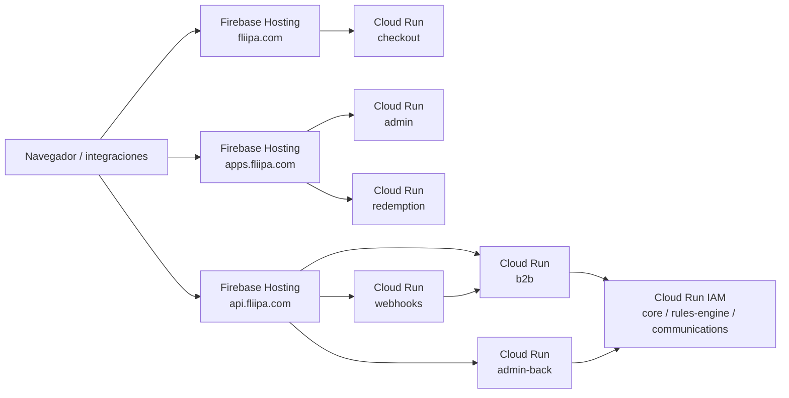

# Dominios públicos y Load Balancer

## Estado actual

PROD está configurado en **Fase F** y usa **Firebase Hosting** como front door para los dominios públicos. Hosting entrega TLS/CDN y reescribe las solicitudes hacia los servicios públicos de Cloud Run. No hay un HTTPS Load Balancer de GCP configurado delante de esta flota; por tanto, un LB es una opción futura, no un prerrequisito para los dominios que ya usa la aplicación.

Los orígenes y paths de aplicación están versionados en [`config/deploy/domains.prod.env`](https://github.com/SumzCol/credits-platform/blob/main/config/deploy/domains.prod.env). La infraestructura de Firebase Hosting y sus dominios se declaran en [`terraform/envs/prod/main.tf`](https://github.com/SumzCol/credits-platform/blob/main/terraform/envs/prod/main.tf); las reglas de rewrite se versionan por entorno en `terraform/envs/{prod,dev}/firebase.json` y se publican con Firebase CLI desde los workflows de deploy, no mediante `tofu apply`.

| Entorno | Raíz / checkout | Apps / admin y redemption | APIs públicas |
|---|---|---|---|
| PROD | `https://fliipa.com` | `https://apps.fliipa.com` | `https://api.fliipa.com` |
| DEV / staging | `https://dev.fliipa.com` | `https://dev-apps.fliipa.com` | `https://dev-api.fliipa.com` |

Firebase conserva además sus hosts `*.web.app`. En PROD, [`PUBLIC_WEB_DEFAULT_ORIGIN`](https://github.com/SumzCol/credits-platform/blob/main/config/deploy/domains.prod.env) documenta `https://creds-prod.web.app`, que sigue sirviendo el sitio `web` junto con `apps.fliipa.com`. Los dominios del entorno DEV también están configurados como dominios personalizados en [`config/deploy/domains.dev.env`](https://github.com/SumzCol/credits-platform/blob/main/config/deploy/domains.dev.env).

La configuración del repositorio confirma la fase y los nombres de dominio; no sustituye una comprobación en vivo de DNS, certificado y asignación del dominio en Firebase. Para validar el estado operativo actual, revisar Firebase Hosting y el DNS autoritativo antes de cambios de dominio.

## Enrutamiento activo en PROD

Firebase Hosting conserva el path al reenviar la solicitud. El orden de las reglas importa; en particular, la regla de webhooks debe estar antes de la regla general de B2B. Las reglas activas están en [`terraform/envs/prod/firebase.json`](https://github.com/SumzCol/credits-platform/blob/main/terraform/envs/prod/firebase.json).

| Sitio de Hosting / host | Path | Destino |
|---|---|---|
| `root` / `fliipa.com` | `/**` | `creds-checkout-prod` (checkout sirve la raíz y su landing) |
| `web` / `apps.fliipa.com` | `/redemption`, `/redemption/**` | `creds-redemption-prod` |
| `web` / `apps.fliipa.com` | `/admin`, `/admin/**` | `creds-admin-prod` |
| `web` / `apps.fliipa.com` | `/checkout`, `/checkout/:rest*` | Redirección 302 a `creds-root-prod.web.app` |
| `api` / `api.fliipa.com` | `/api/v1/webhooks/**` | `creds-webhooks-prod` |
| `api` / `api.fliipa.com` | `/admin/**` (incluye `/admin/api/v1/*`) | `creds-admin-back-prod` |
| `api` / `api.fliipa.com` | `/api/**` | `creds-b2b-prod` |

La redirección legacy `/checkout` en el sitio `web` apunta actualmente al host Firebase `creds-root-prod.web.app`, según el `firebase.json` versionado. Si se espera que los enlaces legacy terminen en el dominio personalizado `fliipa.com`, validar y actualizar el destino; no asumir que el rewrite de checkout cambia esa redirección.

Los servicios internos `core`, `rules-engine` y `communications` no se publican en Firebase Hosting ni en el LB opcional. Conservan acceso Cloud Run IAM y reciben llamadas servicio-a-servicio autenticadas. Ver [Arquitectura y entornos](01 Arquitectura y Entornos.md) y [Configuración, variables de entorno y secretos](03 Configuracion y Secretos.md).

### Particularidad de cookies

Firebase Hosting solo permite que la cookie `__session` llegue al backend de Cloud Run; las demás cookies se eliminan antes del rewrite. La aplicación ya se adaptó a este comportamiento: redemption consolida su sesión en `__session` y admin-back usa `Authorization: Bearer`. Al añadir o cambiar autenticación detrás de Hosting, no depender de cookies con otros nombres; para solicitudes XHR, preferir headers. La guía de Firebase describe este comportamiento en [Manage cache behavior](https://firebase.google.com/docs/hosting/manage-cache).

## Fuentes de configuración y despliegue

| Pieza | Responsabilidad |
|---|---|
| [`config/deploy/domains.prod.env`](https://github.com/SumzCol/credits-platform/blob/main/config/deploy/domains.prod.env) | Orígenes y paths públicos usados para calcular URLs del runtime |
| [`scripts/lib/prod_urls.py`](https://github.com/SumzCol/credits-platform/blob/main/scripts/lib/prod_urls.py) | Calcula URLs de servicios, APIs, CORS y orígenes públicos a partir de fase y bindings |
| [`config/deploy/url-bindings.json`](https://github.com/SumzCol/credits-platform/blob/main/config/deploy/url-bindings.json) | Declara URLs que consumen los frontends y servicios |
| [`terraform/envs/prod/main.tf`](https://github.com/SumzCol/credits-platform/blob/main/terraform/envs/prod/main.tf) | Declara los sitios Firebase Hosting y los dominios mediante variables del entorno GitHub `prod` |
| [`terraform/envs/prod/firebase.json`](https://github.com/SumzCol/credits-platform/blob/main/terraform/envs/prod/firebase.json) | Rewrites, redirects y headers cache-control de PROD |
| [`terraform/envs/dev/firebase.json`](https://github.com/SumzCol/credits-platform/blob/main/terraform/envs/dev/firebase.json) | Reglas equivalentes de DEV |
| [`prod-deploy.yml`](https://github.com/SumzCol/credits-platform/blob/main/.github/workflows/prod-deploy.yml) / [`dev-deploy.yml`](https://github.com/SumzCol/credits-platform/blob/main/.github/workflows/dev-deploy.yml) | `tofu apply` administra recursos/dominios; Firebase CLI publica las reglas Hosting |

Los dominios personalizados se pasan a Terraform mediante variables del GitHub Environment: `GCP_CUSTOM_ROOT_DOMAIN_PROD`, `GCP_CUSTOM_DOMAIN_PROD` y `GCP_CUSTOM_API_DOMAIN_PROD` en PROD; DEV usa las mismas variables sin sufijo `_PROD`. El dominio adicional `www.fliipa.com` está en el default de `custom_root_extra_domains` en Terraform PROD. A su vez, `domains.*.env` alimenta la resolución de URLs y los valores `NEXT_PUBLIC_*` de build. Cambiar solo uno de estos lados puede dejar desalineados el dominio registrado, las reglas de Hosting o las URLs compiladas; revisar ambos y desplegar con el workflow del entorno correspondiente.

Después de cambiar orígenes o paths de PROD, sincronizar el registro de URLs y reconstruir las apps cuyo `NEXT_PUBLIC_*` se hornea en la imagen. Consultar [Pipeline CI/CD](02 Pipeline de Despliegue.md) y [Configuración y secretos](03 Configuracion y Secretos.md) para el procedimiento actual.

## Si se evalúa un HTTPS Load Balancer de GCP

Un LB delante de los mismos servicios sería una arquitectura alternativa o una capa adicional que requiere diseño y validación. No se debe cambiar DNS, retirar Firebase Hosting, cambiar `DEPLOY_PHASE` ni desplegar recursos a partir de esta sección: no es un runbook de cutover. Antes de avanzar, confirmar el objetivo (reemplazar Hosting o coexistir), requisitos de CDN/caché, autenticación, certificados, dominio, rollback y quién opera el DNS.

Como mínimo, el diseño tendría que contemplar:

1. IP global y HTTPS Load Balancer con URL map, certificados gestionados y serverless NEGs por servicio público.
2. Paths concretos y orden equivalente al ruteo activo; conservar `/api/v1/webhooks/**` antes de `/api/**` y separar `/admin/**` de la app admin que vive en otro host.
3. Mantener fuera del proxy los servicios internos con acceso IAM.
4. Probar headers, cookies, redirecciones legacy, cache-control, health checks y el recorrido de autenticación en todos los hosts.
5. Planear y verificar DNS/certificados, ventana de cambio, smoke tests y rollback antes de tocar los dominios activos.

La implementación futura debe documentarse y revisarse contra los rewrites reales de [`terraform/envs/prod/firebase.json`](https://github.com/SumzCol/credits-platform/blob/main/terraform/envs/prod/firebase.json), no contra el antiguo plan de cutover de una fase previa.
